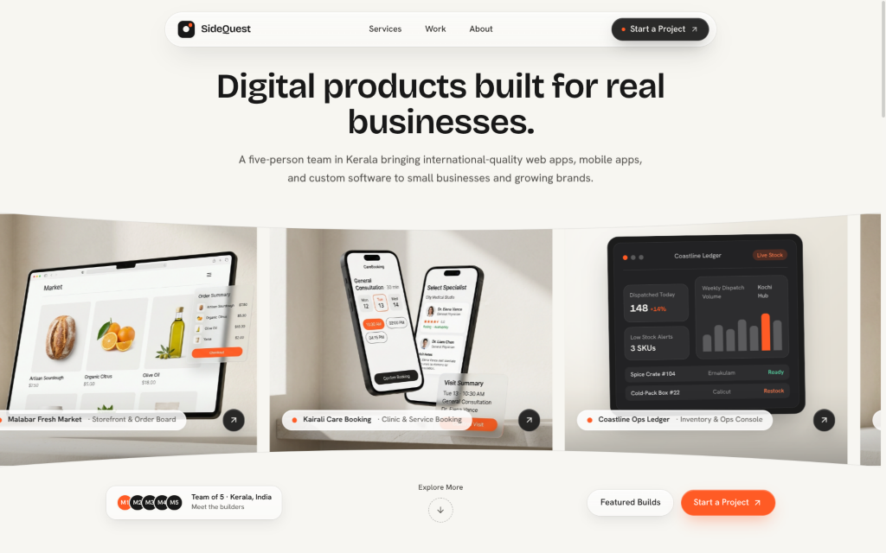
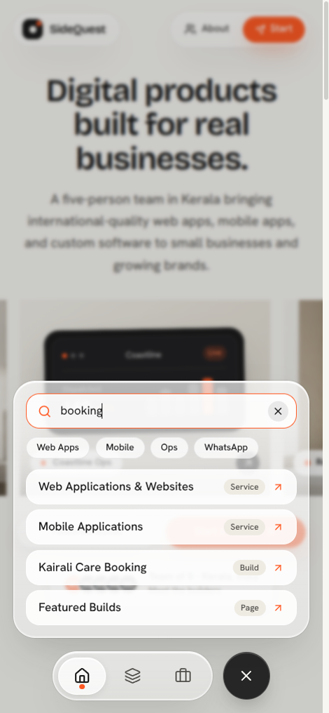

# SideQuest — Agency Website

A frontend-only React + TypeScript marketing website for **SideQuest**, a five-person software agency in Kerala building international-quality web apps, mobile apps, and internal business tools for small businesses, local firms, and growing teams.

Designed with a warm off-white (`#F7F6F2`) canvas, crisp ink-black (`#111111`) typography, subtle orange (`#FF5A1F`) accents, and translucent Liquid Glass surfaces—featuring strictly isolated **Desktop (`>= 1024px`)** and **Mobile (`< 1024px`)** shells.

---

## Screenshots

### Desktop (`1440×900`)

| Home Hero & Curved Carousel | Featured Builds (`/work`) |
| :---: | :---: |
|  |  |

### Mobile (`390×844`)

| Mobile Home & Bottom Dock | Animated Keyword Search |
| :---: | :---: |
|  |  |

---

## Key Features

### Visual & Interaction Craft
- **Liquid Glass Chrome**: Translucent gradient frosted glass (`backdrop-filter: blur(...) saturate(...)`) with luminous specular rims across floating navbars, buttons, and cards.
- **Panoramic Concave-Curved Carousel**: Continuous smooth marquee framed by curved top/bottom SVG arcs, hover-to-pause behavior, and click-through links to each Featured Build.
- **GPU-Composited Scroll Choreography**: Powered by `motion` (`motion/react`), animating exclusively `transform` and `opacity` with delayed viewport triggers (`margin: '0px 0px -18% 0px'`) and global `<MotionConfig reducedMotion="user">` support for 60fps smoothness on budget laptops and phones.
- **Self-Hosted Typography**: Local variable `.woff2` fonts (`Bricolage Grotesque` display + `Hanken Grotesk` UI/body) served from `public/fonts/`.

### Isolated Desktop & Mobile Experiences
- **Desktop (`>= 1024px`)**:
  - Floating Liquid Glass top navbar with steady scroll height, animated hover underlines, and spring-animated active route pills (`layoutId="navbar-active-pill"`).
  - Split interactive Service Pillars tab selector + live preview panel.
  - Multi-column asymmetric grids across Home, Services, Work, About, and Contact.
- **Mobile (`< 1024px`)**:
  - Split floating Liquid Glass top pills (`SideQuest` on the left; `About` and `Start` with icons on the right).
  - Icon-only 3-tab Liquid Glass bottom dock (`Home`, `Services`, `Work`) paired with a **separate floating Search button** (`MobileNav.tsx`).
  - Upward-animating Liquid Glass Search Sheet with quick keyword tags (`Web Apps`, `Mobile`, `Inventory`, `Booking`, `Quote`, `WhatsApp`) filtering across **Service Pillars**, **Featured Builds**, **Pages**, and **Direct Channels**.
  - `1.35`-card mobile curved hero carousel (`MobileHeroCarousel.tsx`) and inline animated Service Pillar accordions.

### Multi-Page Routes
- `/` — Hero showcase, positioning split, Service Pillars switcher/accordion, Featured Builds preview, and closing CTA.
- `/services` — Four **Service Pillars** (`Web Applications & Websites`, `Mobile Applications`, `Business Automation & Internal Tools`, `UI/UX & Digital Launch`) + sequential 3-step `Discover → Build → Launch` process.
- `/work` — Filterable portfolio of template **Featured Builds** (`All`, `Web Apps`, `Mobile Apps`, `Operations`).
- `/work/:slug` — Dedicated build breakdown (Client Challenge, Solution, Core Deliverables, Technology Stack, Live Link slot).
- `/about` — Kerala-to-international positioning, studio principles, and 5 editable **Team Member** slots.
- `/contact` — Validated 4-field **Inquiry** form (supports zero-backend form endpoints via `VITE_FORM_ENDPOINT` with built-in preview + `mailto:` fallback) alongside **WhatsApp**, **Instagram**, and **Direct Email** Direct Channel cards.

---

## Tech Stack

| Layer | Choice |
| :--- | :--- |
| Framework | React 19 + TypeScript |
| Build Tool | Vite 8 |
| Styling | Tailwind CSS v4 (`@tailwindcss/vite`) |
| Routing | React Router v7 (`react-router-dom`) |
| Motion | `motion` (`motion/react`) |
| Icons | `lucide-react` |

---

## Project Structure

```text
.
├── docs/
│   ├── adr/
│   │   ├── 0001-static-react-website-architecture.md
│   │   ├── 0002-compositor-only-scroll-motion.md
│   │   └── 0003-isolated-mobile-navigation-and-layout.md
│   └── screenshots/
│       ├── desktop-hero.png
│       ├── desktop-work.png
│       ├── mobile-home.png
│       └── mobile-search.png
├── public/
│   ├── favicon.svg
│   ├── fonts/                     # Self-hosted Bricolage Grotesque & Hanken Grotesk WOFF2
│   └── images/                    # Studio product renders for Featured Builds
├── src/
│   ├── components/
│   │   ├── BuildVisual.tsx        # Studio raster or live interactive Ops Console preview
│   │   ├── ChannelIcon.tsx        # Unified-stroke icons for Direct Channels
│   │   ├── CurvedHeroCarousel.tsx # Desktop concave-curved panoramic marquee
│   │   ├── Footer.tsx
│   │   ├── Layout.tsx
│   │   ├── MobileHeroCarousel.tsx # Isolated <1024px curved hero carousel
│   │   ├── MobileNav.tsx          # Slim mobile header, icon dock & animated Search sheet
│   │   ├── MotionPrimitives.tsx   # Compositor-only Reveal & RevealStagger helpers
│   │   └── Navbar.tsx             # Desktop (>=1024px) Liquid Glass top navigation
│   ├── data/
│   │   ├── agency.ts              # Central content, links, builds, services & team data
│   │   └── searchIndex.ts         # Keyword index powering the mobile Search sheet
│   ├── pages/
│   │   ├── AboutPage.tsx
│   │   ├── BuildDetailPage.tsx
│   │   ├── ContactPage.tsx
│   │   ├── HomePage.tsx
│   │   ├── NotFoundPage.tsx
│   │   ├── ServicesPage.tsx
│   │   └── WorkPage.tsx
│   ├── App.tsx
│   ├── index.css
│   └── main.tsx
├── GLOSSARY.md                    # Canonical domain terminology
├── index.html
├── package.json
├── tsconfig.json
└── vite.config.ts
```

---

## Local Development

### Prerequisites
- Node.js `>= 20` (verified on `v22.22.1`)
- `npm`

### Commands

```bash
# 1. Install dependencies
npm install

# 2. Start local development server
npm run dev

# 3. Typecheck only
npm run typecheck

# 4. Typecheck and build production bundle into dist/
npm run build

# 5. Preview the production build locally
npm run preview
```

---

## Customizing Content & Going Live

All agency details, placeholder builds, links, and team slots live in **[`src/data/agency.ts`](src/data/agency.ts)**:

1. **Connect the Inquiry Form Email Endpoint**:
   - Create a free form endpoint on [Web3Forms](https://web3forms.com/) or [Formspree](https://formspree.io/).
   - Either set `VITE_FORM_ENDPOINT=https://...` in a local `.env` file, or paste it directly into `AGENCY_CONFIG.inquiryEndpoint` inside `src/data/agency.ts`.
   - Without an endpoint set, the Contact form safely runs in **Prototype Mode** and offers a pre-filled `mailto:` fallback.
2. **Update Direct Channels (`WhatsApp`, `Instagram`, `Email`)**:
   - Edit `AGENCY_CONFIG.contactEmail`, `AGENCY_CONFIG.whatsappHref`, `AGENCY_CONFIG.instagramHref`, and `DIRECT_CHANNELS` handles in `src/data/agency.ts`.
3. **Replace Template Featured Builds & Team Profiles**:
   - Update `FEATURED_BUILDS` (titles, client types, summaries, `liveUrlPlaceholder`, and images in `public/images/`) and `TEAM_MEMBERS` in `src/data/agency.ts`.
   - Mobile keyword search in `src/data/searchIndex.ts` reads directly from `SERVICE_PILLARS`, `FEATURED_BUILDS`, and `DIRECT_CHANNELS`, so updates propagate automatically.

---

## Domain & Architecture Documentation

- **[GLOSSARY.md](GLOSSARY.md)** — Shared domain language (`SideQuest`, `Client`, `Featured Build`, `Inquiry`, `Direct Channel`, `Service Pillar`, `Team Member`).
- **[ADR 0001 — Static React Website Architecture](docs/adr/0001-static-react-website-architecture.md)**
- **[ADR 0002 — Compositor-Only Scroll Motion](docs/adr/0002-compositor-only-scroll-motion.md)**
- **[ADR 0003 — Isolated Mobile Navigation and Layout](docs/adr/0003-isolated-mobile-navigation-and-layout.md)**
