# SideQuest — Agency Website

**SideQuest** is the official website for a five-person software agency based in **Kerala, India** that builds international-quality web applications, mobile apps, and custom business software for small businesses, local firms, small agencies, and growing startups.

It is a **100% frontend website** (no custom server or database required) built with React and TypeScript, designed from the ground up with two carefully tailored experiences:
- **Desktop (`1024px` and wider)**: A spacious, editorial layout with a floating frosted-glass navigation bar, a panoramic curved product showcase carousel, and interactive service tabs.
- **Mobile (phones & smaller screens)**: A thumb-friendly layout with split floating top pills, an icon-only floating glass bottom dock, and an upward-animating **keyword Search bar** that lets visitors jump straight to services, builds, or WhatsApp in two taps.

> **Live Website:** [https://salman5900.github.io/Agency-Website/](https://salman5900.github.io/Agency-Website/)

---

## Visual Tour (Desktop & Mobile)

Every page has been designed and tested separately for both **Desktop (`1440×900`)** and **Mobile (`390×844`)** so neither compromises the other.

### 1. Home (`/`) — Curved Hero Carousel & Interactive Pillars
Visitors immediately see what SideQuest builds through a continuously spinning **concave-curved showcase strip** (hover to pause, click any card to inspect that build). Below the hero sits the Team of 5 badge, why SideQuest exists, an interactive Service Pillars selector (desktop tabs / mobile inline accordion), Featured Builds, and a direct call-to-action.

| Desktop (`1440×900`) | Mobile (`390×844`) |
| :---: | :---: |
|  | 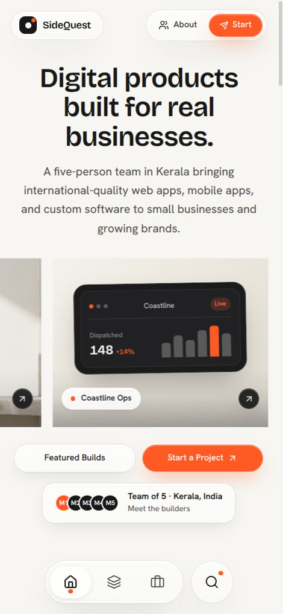 |

---

### 2. Mobile Keyword Search (Mobile Dock)
On mobile, tapping the detached circular **Search** button next to the bottom dock smoothly slides up a frosted Liquid Glass search card. Visitors can tap quick tags (`Web Apps`, `Mobile`, `Ops`, `WhatsApp`) or type any keyword (like `booking` or `grocery`) and jump straight to the matching service, build, page, or contact channel.

<p align="center">
  
</p>

---

### 3. Services (`/services`) — Four Pillars & 3-Step Process
Explains what SideQuest delivers in plain language across four **Service Pillars** (*Web Applications & Websites*, *Mobile Applications*, *Business Automation & Internal Tools*, and *UI/UX & Digital Launch*), followed by a transparent three-step workflow (**1. Discover → 2. Build → 3. Launch**) with custom quotes instead of rigid packages.

| Desktop (`1440×900`) | Mobile (`390×844`) |
| :---: | :---: |
| 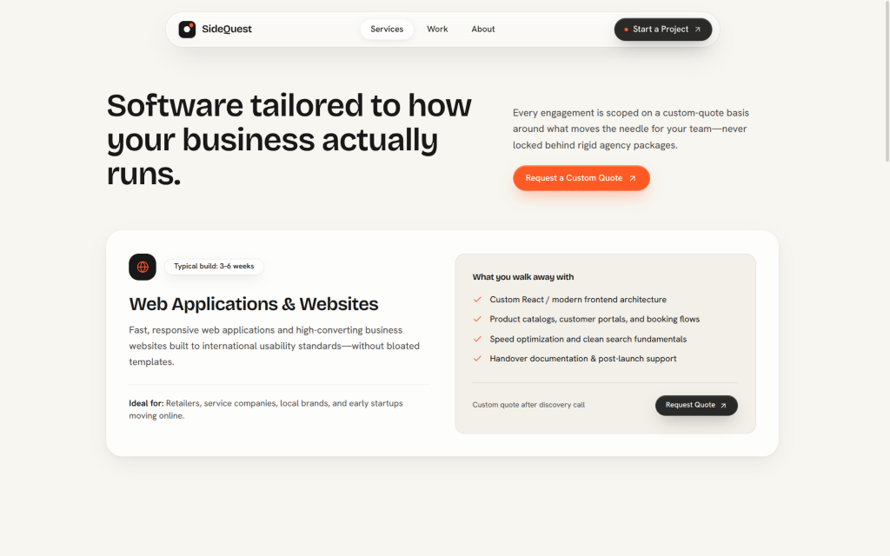 | 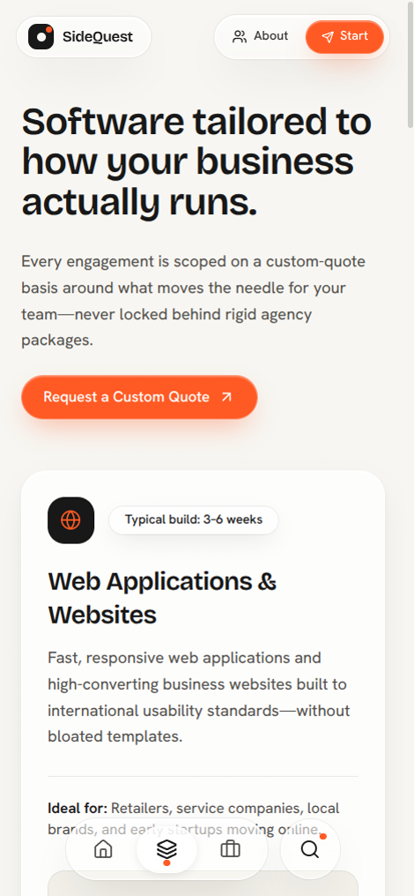 |

---

### 4. Work (`/work`) — Filterable Featured Builds
Showcases three template **Featured Builds** (*Malabar Fresh Market*, *Kairali Care Booking*, *Coastline Ops Ledger*) with category filter pills (`All`, `Web Apps`, `Mobile Apps`, `Operations`). These templates visualize real small-business solutions and are ready to swap with live client links.

| Desktop (`1440×900`) | Mobile (`390×844`) |
| :---: | :---: |
| 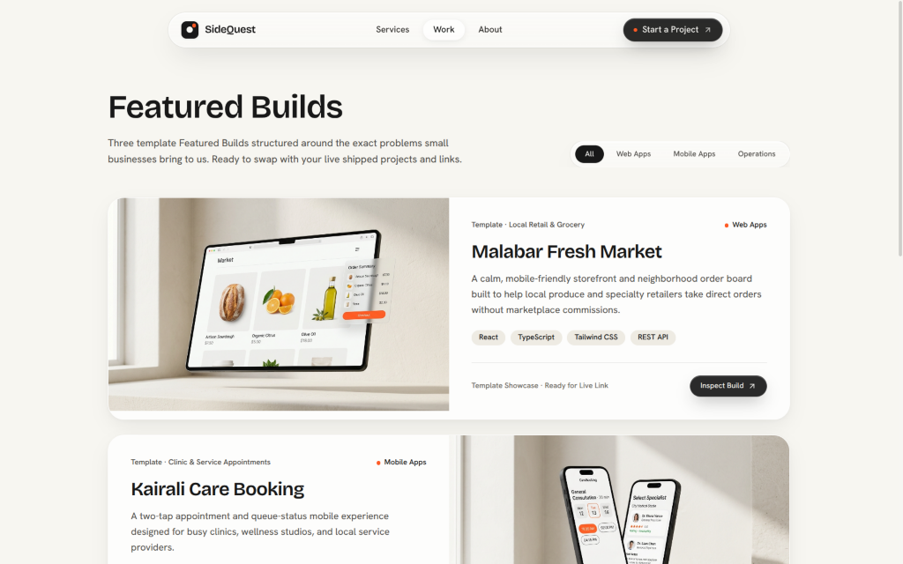 | 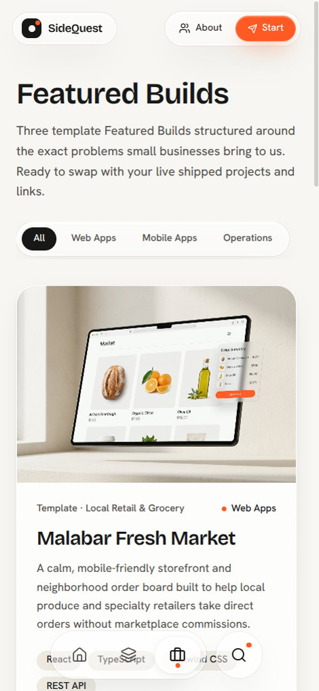 |

---

### 5. Featured Build Detail (`/work/:slug`)
Clicking any project opens a dedicated breakdown covering the **Client Challenge**, **How SideQuest Solved It**, **Core Deliverables**, **Technology Stack**, a **Live Link** slot, and a quick jump to the next build.

| Desktop (`1440×900`) | Mobile (`390×844`) |
| :---: | :---: |
| 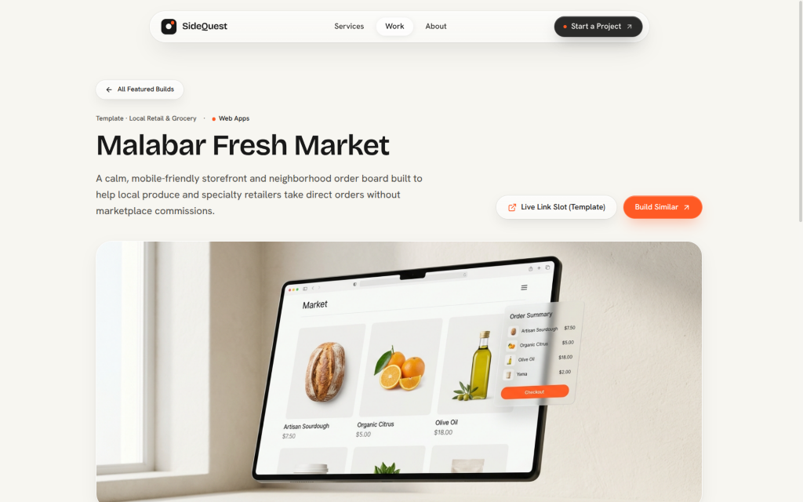 | 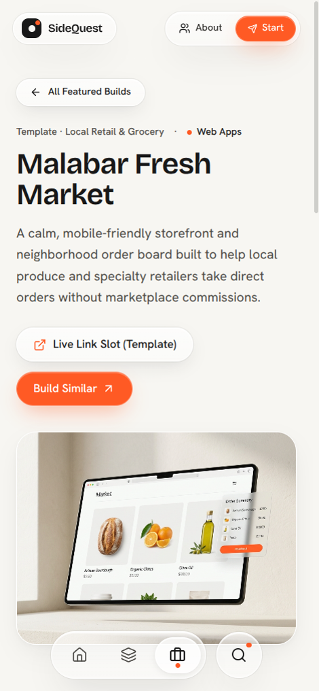 |

---

### 6. About (`/about`) — Kerala Roots & The Team of Five
Shares SideQuest’s story—bringing international-grade design and engineering to everyday businesses—alongside three studio principles and five editable **Team Member** cards covering design, frontend, backend, mobile, and delivery/QA.

| Desktop (`1440×900`) | Mobile (`390×844`) |
| :---: | :---: |
| 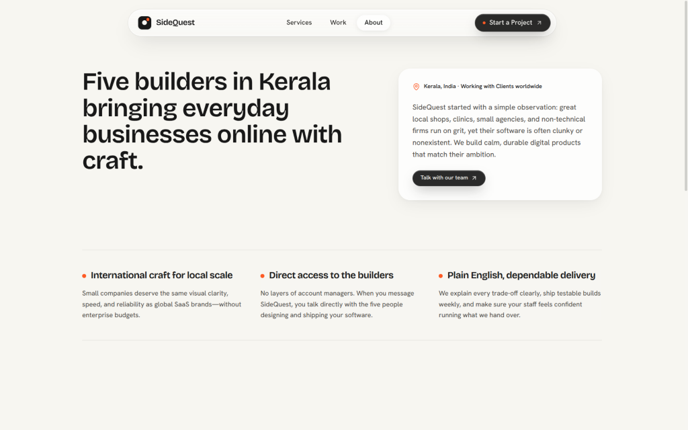 | 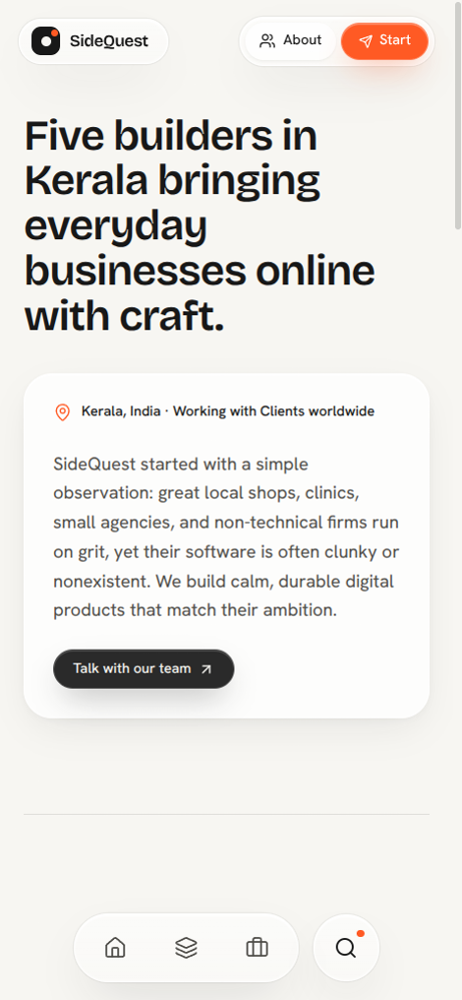 |

---

### 7. Contact (`/contact`) — Project Inquiry Form & Direct Channels
Gives prospective clients multiple easy ways to reach out: a clean 4-field **Inquiry form** (`Name`, `Email`, `Business / Project Type`, `Message`) that forwards to your inbox, plus clickable **WhatsApp**, **Instagram**, and **Direct Email** cards. On mobile, the Inquiry form appears first so users can message right away.

| Desktop (`1440×900`) | Mobile (`390×844`) |
| :---: | :---: |
| 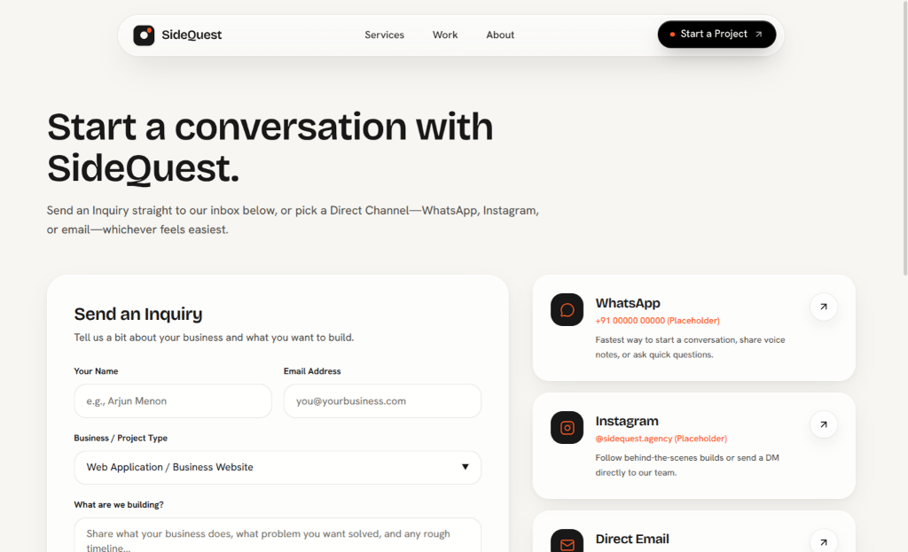 | 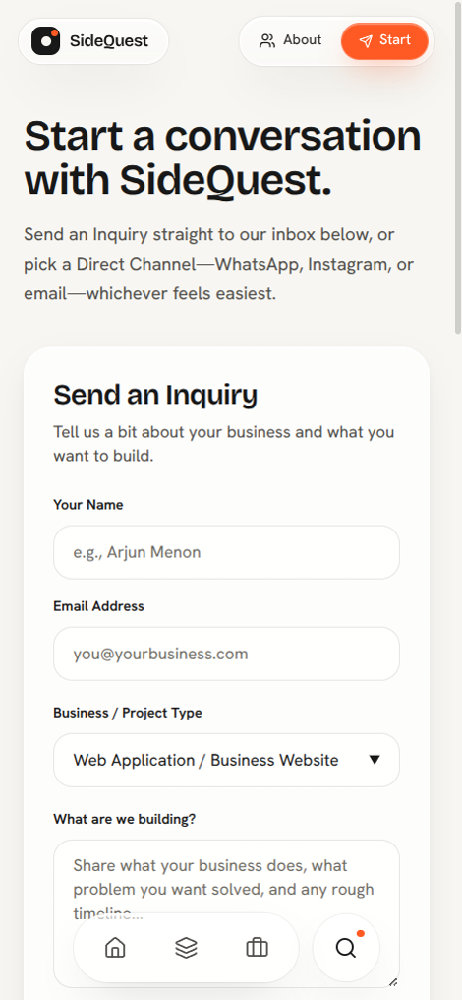 |

---

## Design & Engineering Highlights

- **Warm Off-White, Black & Subtle Orange Palette**: Uses an alabaster off-white canvas (`#F7F6F2`), crisp ink black (`#111111`), and deliberate orange (`#FF5A1F`) accents across active dots, focus states, and primary calls to action.
- **Apple-Inspired Liquid Glass Chrome**: Floating navbars, buttons, and cards use translucent frosted glass gradients (`backdrop-filter: blur(...) saturate(...)`) with specular inner rim highlights.
- **Smooth Animations on All Hardware**: Powered by `motion` (`motion/react`), scroll reveals animate **only `transform` and `opacity`** (never expensive animated blur filters) and wait until sections reach the comfortable lower-middle reading zone (`margin: '0px 0px -18% 0px'`) before stepping in sequentially—keeping scrolling smooth even on budget laptops and phones.
- **Strict Desktop/Mobile Isolation**: Desktop (`>= 1024px`) and Mobile (`< 1024px`) navigation, hero carousels, and Service Pillar interactions are separated cleanly so tuning mobile never breaks desktop.
- **GitHub Pages Ready (Clean URLs)**: Configured with `/Agency-Website/` base path handling, self-hosted fonts bundled by Vite, and a `public/404.html` redirect so refreshing any page link (`/services`, `/work/malabar-fresh-commerce`) works seamlessly on GitHub Pages.

---

## How to Customize Content (Quick Edit Guide)

Almost everything a team member or business owner needs to update lives in **one file**: **[`src/data/agency.ts`](src/data/agency.ts)**.

1. **Receive Contact Form Emails**:
   - Sign up for a free static form endpoint on [Web3Forms](https://web3forms.com/) or [Formspree](https://formspree.io/).
   - Paste your endpoint URL into `AGENCY_CONFIG.inquiryEndpoint` in `src/data/agency.ts` (or set `VITE_FORM_ENDPOINT` in your environment / GitHub Actions secrets).
   - *Until an endpoint is added, the form safely runs in **Prototype Mode** with a one-click pre-filled `mailto:` fallback.*
2. **Update WhatsApp, Instagram & Email Links**:
   - Edit `AGENCY_CONFIG.contactEmail`, `AGENCY_CONFIG.whatsappHref`, `AGENCY_CONFIG.instagramHref`, and `DIRECT_CHANNELS` inside `src/data/agency.ts`.
3. **Swap in Real Projects & Team Bios**:
   - Replace the 3 placeholder entries in `FEATURED_BUILDS` (drop your new project screenshots into `public/images/` and reference them with `assetUrl('images/your-file.jpg')`) and edit `TEAM_MEMBERS` in `src/data/agency.ts`.
   - Mobile keyword search (`src/data/searchIndex.ts`) reads directly from `src/data/agency.ts`, so updates automatically appear in mobile search too.

---

## Deploying to GitHub Pages

This project uses the [`gh-pages`](https://www.npmjs.com/package/gh-pages) package (`predeploy` + `deploy` scripts in `package.json`) to publish `dist/` cleanly to the `gh-pages` branch.

### Deploy Steps
1. Build and publish the site to the `gh-pages` branch:
   ```bash
   npm run deploy
   ```
2. On GitHub (`salman5900/Agency-Website`), open **Settings → Pages**.
3. Under **Build and deployment → Source**, confirm **Deploy from a branch** is selected with branch **`gh-pages`** (`/ (root)`). *(GitHub usually sets this automatically right after your first `npm run deploy`.)*
4. Visit your live website:
   **[https://salman5900.github.io/Agency-Website/](https://salman5900.github.io/Agency-Website/)**

*(If you later connect a custom domain like `sidequest.in`, set `VITE_BASE_PATH=/` when building and update `pathSegmentsToKeep = 0` in `public/404.html`.)*

---

## Local Development (For Developers)

### Tech Stack
- **React 19** + **TypeScript**
- **Vite 8** + **Tailwind CSS v4** (`@tailwindcss/vite`)
- **React Router v7** (`react-router-dom`)
- **Motion** (`motion/react`) + **Lucide Icons** (`lucide-react`)
- **Self-hosted fonts**: `Bricolage Grotesque` & `Hanken Grotesk` (`src/assets/fonts/`)

### Commands

```bash
# Install packages
npm install

# Start local dev server (http://localhost:5173/)
npm run dev

# Typecheck only
npm run typecheck

# Typecheck and build production bundle into dist/
npm run build

# Preview the production build locally (http://localhost:4173/Agency-Website/)
npm run preview

# Build and deploy dist/ to the gh-pages branch on GitHub Pages
npm run deploy
```

### Project Structure

```text
.
├── docs/
│   ├── adr/                         # Architecture Decision Records (0001–0004)
│   └── screenshots/                 # Desktop & Mobile screenshots for all pages
├── public/
│   ├── 404.html                     # Clean-URL SPA redirect for GitHub Pages
│   ├── favicon.svg
│   └── images/                      # Studio renders for Featured Builds
├── src/
│   ├── assets/fonts/                # Self-hosted variable .woff2 fonts
│   ├── components/
│   │   ├── BuildVisual.tsx          # Studio product image or mobile/desktop Ops UI
│   │   ├── ChannelIcon.tsx          # Unified icons for WhatsApp, Instagram & Email
│   │   ├── CurvedHeroCarousel.tsx   # Desktop panoramic concave-curved marquee
│   │   ├── Footer.tsx
│   │   ├── Layout.tsx
│   │   ├── MobileHeroCarousel.tsx   # Mobile (<1024px) curved hero carousel
│   │   ├── MobileNav.tsx            # Split top pills, icon dock & animated Search sheet
│   │   ├── MotionPrimitives.tsx     # Compositor-only Reveal & RevealStagger helpers
│   │   └── Navbar.tsx               # Desktop (>=1024px) Liquid Glass top navigation
│   ├── data/
│   │   ├── agency.ts                # Central config, services, builds & team profiles
│   │   └── searchIndex.ts           # Keyword search index for mobile dock
│   ├── pages/
│   │   ├── AboutPage.tsx
│   │   ├── BuildDetailPage.tsx
│   │   ├── ContactPage.tsx
│   │   ├── HomePage.tsx
│   │   ├── NotFoundPage.tsx
│   │   ├── ServicesPage.tsx
│   │   └── WorkPage.tsx
│   ├── App.tsx
│   ├── index.css
│   └── main.tsx
├── .gitignore
├── GLOSSARY.md                      # Shared project terminology
├── index.html
├── package.json
├── tsconfig.json
└── vite.config.ts
```

---

## Documentation & Decisions

- **[GLOSSARY.md](GLOSSARY.md)** — Canonical domain terms (`SideQuest`, `Client`, `Featured Build`, `Inquiry`, `Direct Channel`, `Service Pillar`, `Team Member`).
- **[ADR 0001 — Static React Website Architecture](docs/adr/0001-static-react-website-architecture.md)**
- **[ADR 0002 — Compositor-Only Scroll Motion](docs/adr/0002-compositor-only-scroll-motion.md)**
- **[ADR 0003 — Isolated Mobile Navigation and Layout](docs/adr/0003-isolated-mobile-navigation-and-layout.md)**
- **[ADR 0004 — GitHub Pages SPA Deployment](docs/adr/0004-github-pages-spa-deployment.md)**
